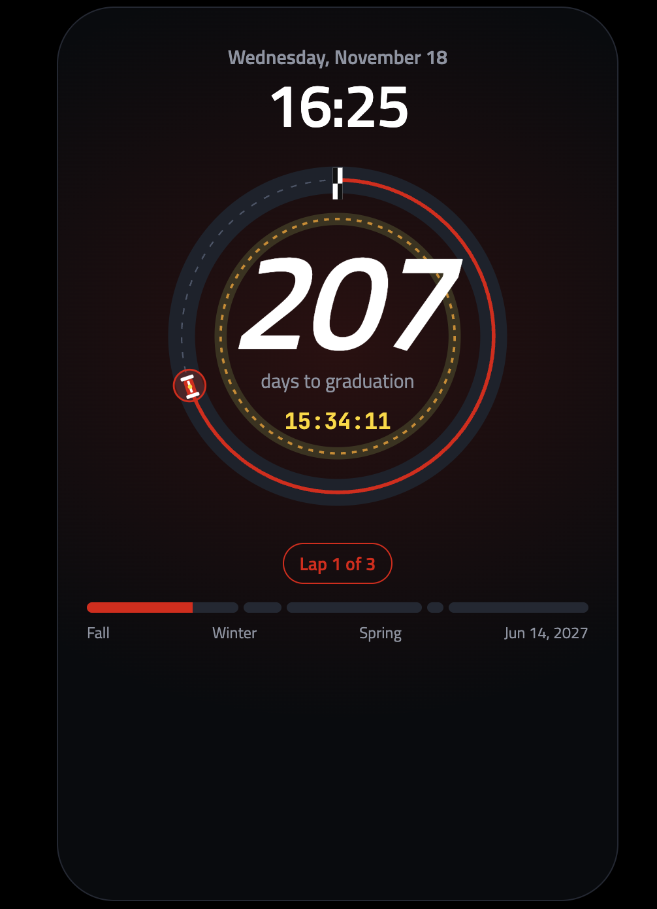

# 🏁 Graduation GP

A live Formula 1 themed lock-screen countdown to graduation (June 14, 2027). Each academic term is a **lap**, each break is a **pit stop**, and a tiny race car circles the track as the school year goes by.

Started as an entry in a lock-screen wallpaper contest, built with Google Gemini, then refined into a phone-first web app.



**Live demo:** https://rbn2003.github.io/Graduation_GP/

## Features

- Live countdown to the finish line, to the second
- Car animated around a circular track; during breaks it diverts into an inner pit lane
- Lap and pit-stop progress bar, finals-week "sprint" status, next-milestone tracker
- Time-travel slider and **Play** mode that runs the full 266-day season in about 16 seconds
- Reduced-motion friendly, no build step, no dependencies

## Use it as a wallpaper

Web pages can't be live wallpapers, so screenshot the page and set it as your lock screen:

- `index.html#wallpaper` hides the controls and keeps the clock
- `index.html#wallpaper-phone` also leaves the clock area blank for your phone's own clock

## How it works

A function maps any date to a lap, pit stop, or finals window plus a 0–1 progress value. That value places the car on the outer track ring, or on the smaller inner ring during breaks. Vanilla HTML, CSS, and JavaScript in a single file.

## Customize

Edit the `STINTS`, `MILESTONES`, `START`, and `GRAD` constants in the `<script>` block of `index.html`.

## Run locally

```bash
git clone https://github.com/rbn2003/graduation_gp.git
cd graduation-gp
open index.html
```

## Deploy

Repo **Settings → Pages → Deploy from branch → main / root**.

## Roadmap

- [ ] Desktop dashboard view with a full circuit map
- [ ] Config panel for custom schedules and dates
- [ ] Shareable links with your own graduation date

## License

MIT
